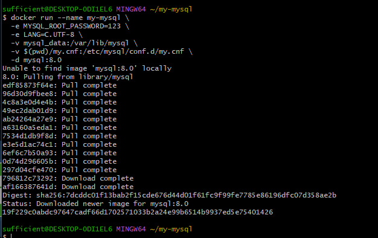
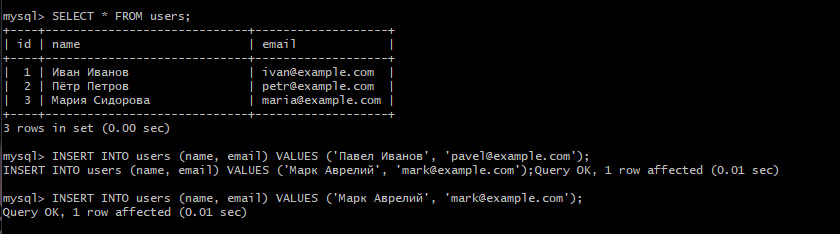
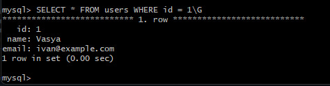

<h1 align="center">🐬 Интерактивная работа с MySQL в Docker</h1>
<h1 align="center">[🐬 Интерактивная работа с MySQL в Docker 2](/README2.md)</h1>

<p align="center">
  
  
  
  
</p>

<p align="center">
  Учебный проект по работе с MySQL в изолированном окружении Docker:<br>
  запуск «чистого» контейнера, подключение, основные SQL-операции и создание дампа базы данных.
</p>

---

## 📑 Содержание

- [📋 Требования](#-требования)
- [🚀 Шаг 1. Запуск контейнера MySQL](#-шаг-1-запуск-контейнера-mysql)
- [🔌 Шаг 2. Подключение к MySQL](#-шаг-2-подключение-к-mysql)
- [🛠️ Шаг 3. Основные операции с БД и таблицами](#️-шаг-3-основные-операции-с-бд-и-таблицами)
- [📝 Шаг 4. Логи и дамп базы данных](#-шаг-4-логи-и-дамп-базы-данных)
- [🧹 Шаг 5. Управление Docker-контейнером](#-шаг-5-управление-docker-контейнером)
- [📌 Шпаргалка команд](#-шпаргалка-команд)

---

## 📋 Требования

| Компонент | Версия / Примечание |
|-----------|---------------------|
| 🐳 Docker | Установленный и запущенный |
| 🐬 MySQL | Образ `mysql:8.0` (LTS) |
| 💻 Терминал | Bash / Zsh / любой POSIX-совместимый |

> ⚠️ **Важно:** тег `latest` может указывать на инновационную ветку (например, 26.x), не предназначенную для стабильной учебной работы. Используйте `mysql:8.0`.

---

## 🚀 Шаг 1. Запуск контейнера MySQL

### Подготовка Docker

> ⚠️ Команды ниже удаляют **только учебные** ресурсы. Если на хосте есть другие важные контейнеры — не используйте широкие команды очистки.

```shell
# Список текущих контейнеров
docker ps -a

# Остановить и удалить учебный контейнер (если существует)
docker stop my-mysql 2>/dev/null
docker rm my-mysql 2>/dev/null

# Удалить volume учебного проекта
docker volume rm mysql_data 2>/dev/null
```

<details>
<summary>💡 Если уверены, что других важных контейнеров нет (нажмите, чтобы развернуть)</summary>

```shell
docker stop $(docker ps -q)
docker container prune
docker volume prune -a
```

**Будьте осторожны** — эти команды удаляют всё неиспользуемое на хосте.
</details>

### Создание каталога проекта

```shell
mkdir my-mysql && cd my-mysql
```

Создайте файл `my.cnf`:

```ini
[mysqld]
character-set-server = utf8mb4
collation-server = utf8mb4_unicode_ci
general_log = 1
general_log_file = /var/lib/mysql/general.log
log_output = FILE

[client]
default-character-set = utf8mb4

[mysql]
default-character-set = utf8mb4
```

### Запуск контейнера

```bash
docker run --name my-mysql \
  -e MYSQL_ROOT_PASSWORD=123 \
  -e LANG=C.UTF-8 \
  -v mysql_data:/var/lib/mysql \
  -v $(pwd)/my.cnf:/etc/mysql/conf.d/my.cnf \
  -d mysql:8.0
```

**Разбор параметров:**

| Флаг | Назначение |
|------|-----------|
| `--name my-mysql` | Понятное имя контейнера |
| `-e MYSQL_ROOT_PASSWORD=123` | Пароль `root` (учебный!) |
| `-e LANG=C.UTF-8` | UTF-8 локаль для кириллицы |
| `-v mysql_data:/var/lib/mysql` | Volume для данных |
| `-v $(pwd)/my.cnf:...` | Монтирование конфига |
| `-d` | Фоновый режим (detached) |
| `mysql:8.0` | LTS-версия образа |

Проверка, что контейнер работает:

```bash
docker ps
```

### Где физически хранятся данные?

```shell
docker exec -it my-mysql ls -la /var/lib/mysql
```

Пример вывода:

```text
drwxr-xr-x  mysql mysql  ibdata1
drwxr-xr-x  mysql mysql  ib_logfile0
drwxr-xr-x  mysql mysql  ib_logfile1
drwxr-xr-x  mysql mysql  #innodb_temp
drwxr-xr-x  mysql mysql  mysql/
drwxr-xr-x  mysql mysql  performance_schema/
drwxr-xr-x  mysql mysql  sys/
```

> После создания базы `my_database` здесь появится подкаталог `my_database/` с файлами таблиц.

---

## 🔌 Шаг 2. Подключение к MySQL

```bash
docker exec -it my-mysql mysql --default-character-set=utf8mb4 -uroot -p
```

Введите пароль `123`. Появится приглашение `mysql>`.

| Флаг | Назначение |
|------|-----------|
| `-i` | interactive |
| `-t` | tty (терминал) |
| `mysql -uroot -p` | Клиент MySQL от `root` с запросом пароля |

---

## 🛠️ Шаг 3. Основные операции с БД и таблицами

### Проверка кодировки

```sql
SHOW VARIABLES LIKE 'character_set%';
```

> `character_set_client`, `character_set_connection`, `character_set_results` должны быть `utf8mb4`.

### 1. Просмотр баз данных

```sql
SHOW DATABASES;
```

> Системные БД (`information_schema`, `mysql`, `performance_schema`, `sys`) трогать не нужно.

### 2. Создание базы и таблицы

```sql
CREATE DATABASE my_database
  CHARACTER SET utf8mb4
  COLLATE utf8mb4_unicode_ci;

USE my_database;

CREATE TABLE users (
    id INT AUTO_INCREMENT PRIMARY KEY,
    name VARCHAR(100) NOT NULL,
    email VARCHAR(100) NOT NULL UNIQUE
) CHARACTER SET utf8mb4 COLLATE utf8mb4_unicode_ci;

INSERT INTO users (name, email) VALUES
  ('Иван Иванов', 'ivan@example.com'),
  ('Пётр Петров', 'petr@example.com'),
  ('Мария Сидорова', 'maria@example.com');

SELECT * FROM users;
```

### 3. Выбор БД и просмотр таблиц

```sql
USE my_database;
SHOW TABLES;
```

### 4. Вставка данных

```sql
INSERT INTO users (name, email) VALUES ('Павел Иванов', 'pavel@example.com');
INSERT INTO users (name, email) VALUES ('Марк Аврелий', 'mark@example.com');
```

Проверка байтов строки (опционально):

```sql
SELECT name, HEX(name) FROM users WHERE id = 1;
```

> Для `utf8mb4` кириллица занимает 2 байта на символ — это нормально.

### 5. Просмотр данных

```sql
SELECT * FROM users;                           -- все строки
SELECT * FROM users WHERE id = 1;              -- конкретная строка
SELECT name, email FROM users;                 -- выбранные поля
SELECT name FROM users;                        -- одно поле
SELECT name, email FROM users WHERE id = 1;    -- поля для записи
SELECT * FROM users WHERE id = 1\G             -- вертикальный вывод
```

> `\G` заменяет точку с запятой и не требует `;` в конце.

### 6. Обновление данных

```sql
UPDATE users SET name = 'Иван Петров' WHERE id = 1;
UPDATE users SET name = 'Vasya'       WHERE id = 1;
```

### 7. Удаление данных

```sql
DELETE FROM users WHERE id = 2;
```

> ⚠️ Если удалить `WHERE`, удалятся **все** строки.

### 8. Удаление таблицы

```sql
DROP TABLE users;
SHOW TABLES;
```

### 9. Удаление базы данных

```sql
DROP DATABASE my_database;
SHOW DATABASES;
```

Выход из клиента:

```sql
\q
```

> `exit` и `quit` — синонимы `\q`.

---

## 📝 Шаг 4. Логи и дамп базы данных

Все команды записываются в `/var/lib/mysql/general.log` (при `log_output = FILE`).

### Работа с логом

```shell
# Проверить существование файла
docker exec my-mysql ls -la /var/lib/mysql/general.log

# Заглянуть в лог
docker exec my-mysql cat /var/lib/mysql/general.log

# Забрать лог на хост
docker cp my-mysql:/var/lib/mysql/general.log ./general.log

# Очистить лог внутри контейнера
docker exec my-mysql sh -c ': > /var/lib/mysql/general.log'
```

> 💡 Если нужна фильтрация логов SQL-запросами через `mysql.general_log` — используйте `log_output = TABLE` (см. руководство №2).

### Создание дампа БД

```sql
\q
```

```shell
# Базовый вариант
docker exec my-mysql mysqldump -uroot -p123 my_database > dump.sql

# Без предупреждения о пароле в командной строке
docker exec -e MYSQL_PWD=123 my-mysql mysqldump -uroot my_database > dump.sql

# Рекомендуемый вариант — без GTID и с согласованным снимком
docker exec -e MYSQL_PWD=123 my-mysql mysqldump -uroot \
  --set-gtid-purged=OFF \
  --single-transaction \
  my_database > dump_clean.sql
```

Просмотр дампа:

```shell
cat dump.sql
```

> `.sql`-файл — текстовое представление БД. Его можно хранить как резервную копию и использовать для восстановления.

---

## 🧹 Шаг 5. Управление Docker-контейнером

```bash
# Остановить
docker stop my-mysql

# Запустить ранее остановленный
docker start my-mysql

# Логи контейнера (отладка)
docker logs my-mysql

# Логи в файл
docker logs my-mysql > log.txt
```

### Пересоздание контейнера с сохранением данных

```shell
docker stop my-mysql
docker rm my-mysql
docker run --name my-mysql \
  -e MYSQL_ROOT_PASSWORD=123 \
  -e LANG=C.UTF-8 \
  -v mysql_data:/var/lib/mysql \
  -v $(pwd)/my.cnf:/etc/mysql/conf.d/my.cnf \
  -d mysql:8.0
```

> ⚠️ При переходе с другой major-версии MySQL контейнер может не стартовать — удалите старый volume: `docker volume rm mysql_data` (данные будут потеряны).

---

## 📌 Шпаргалка команд

### Docker

| Команда | Действие |
|---------|----------|
| `docker ps -a` | Все контейнеры |
| `docker stop my-mysql` | Остановить |
| `docker start my-mysql` | Запустить |
| `docker rm my-mysql` | Удалить контейнер |
| `docker volume rm mysql_data` | Удалить volume |
| `docker logs my-mysql` | Логи контейнера |
| `docker exec -it my-mysql bash` | Войти в контейнер |

### MySQL-клиент

| Команда | Действие |
|---------|----------|
| `SHOW DATABASES;` | Список БД |
| `USE db;` | Выбрать БД |
| `SHOW TABLES;` | Список таблиц |
| `SELECT * FROM t;` | Все строки |
| `DESCRIBE t;` | Структура таблицы |
| `\q` | Выход |

---

<p align="center">
  <i>Если вы обнаружили ошибку — сообщите, пожалуйста, автору!</i>
</p>

<p align="center">
  ⭐ Поставьте звезду репозиторию, если материал оказался полезным!
</p>