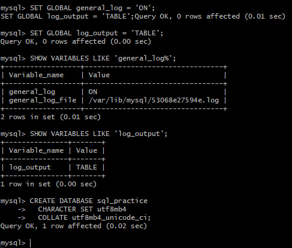
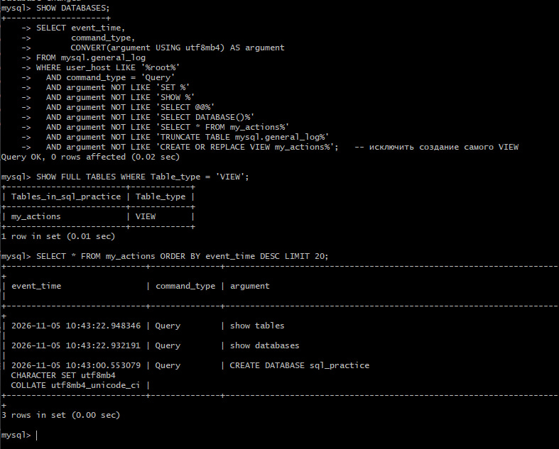
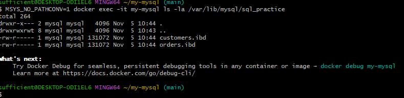

<h1 align="center">🐬 Продвинутая работа с MySQL в Docker — Часть 2</h1>

<p align="center">
  
  
  
  
</p>

<p align="center">
  Логирование в системную таблицу <code>mysql.general_log</code>, фильтрация через VIEW,<br>
  практика SQL: JOIN, GROUP BY, подзапросы, UNION, ALTER TABLE, дамп и восстановление БД.
</p>

---

## 📑 Содержание

- [🔌 Подключение к контейнеру](#-подключение-к-контейнеру)
- [🗄️ Шаг 1. Логирование и создание учебной БД](#️-шаг-1-логирование-и-создание-учебной-бд)
- [📋 Шаг 2. Создание таблиц](#-шаг-2-создание-таблиц)
- [✍️ Шаг 3. Вставка данных (INSERT)](#️-шаг-3-вставка-данных-insert)
- [🔍 Шаг 4. Выборка данных (SELECT)](#-шаг-4-выборка-данных-select)
- [📊 Шаг 5. Агрегатные функции](#-шаг-5-агрегатные-функции)
- [📈 Шаг 6. GROUP BY и HAVING](#-шаг-6-group-by-и-having)
- [🔗 Шаг 7. Соединения JOIN](#-шаг-7-соединения-join)
- [🧩 Шаг 8. Подзапросы и UNION](#-шаг-8-подзапросы-и-union)
- [✏️ Шаг 9. Обновление данных (UPDATE)](#️-шаг-9-обновление-данных-update)
- [🗑️ Шаг 10. Удаление данных (DELETE)](#️-шаг-10-удаление-данных-delete)
- [🏗️ Шаг 11. Изменение структуры (ALTER TABLE)](#️-шаг-11-изменение-структуры-alter-table)
- [📝 Шаг 12. Просмотр лога и создание дампа](#-шаг-12-просмотр-лога-и-создание-дампа)
- [🧨 Шаг 13. Удаление таблиц и базы](#-шаг-13-удаление-таблиц-и-базы)
- [🧨 Шаг 14. Восстановление удалённой БД](#-шаг-14-восстановление-удалённой-бд)
- [🧰 Полезные команды](#-полезные-команды)
- [📝 Что дальше?](#-что-дальше)

---

## 🔌 Подключение к контейнеру

> **Работу можно выполнять в созданном ранее каталоге `my-mysql`, в котором уже есть файл `my.cnf`.**

Замените содержимое `my.cnf`:

```ini
[mysqld]
character-set-server = utf8mb4
collation-server = utf8mb4_unicode_ci
general_log = 1
log_output = TABLE

[client]
default-character-set = utf8mb4

[mysql]
default-character-set = utf8mb4
```

Перезапустите контейнер, чтобы настройки применились:

```shell
docker restart my-mysql
```

Если прежний контейнер удалён — создайте новый:

```shell
# Желательно очистить старый volume
docker volume prune -a
```

> ⚠️ **`docker volume prune -a` удаляет все неиспользуемые тома — используйте с осторожностью!**

```bash
docker run --name my-mysql \
  -e MYSQL_ROOT_PASSWORD=123 \
  -e LANG=C.UTF-8 \
  -e MYSQL_INITDB_SKIP_TZINFO=1 \
  -v mysql_data:/var/lib/mysql \
  -v $(pwd)/my.cnf:/etc/mysql/conf.d/my.cnf \
  -d mysql:8.0
```

Подключитесь к MySQL:

```bash
docker exec -it my-mysql mysql --default-character-set=utf8mb4 -uroot -p
```

Введите пароль `123`. Появится приглашение `mysql>`.

Если получили ошибку:

```text
Enter password:
ERROR 2002 (HY000): Can't connect to local MySQL server through socket '/var/run/mysqld/mysqld.sock' (2)
```

Контейнер ещё инициализируется. Подождите 10–20 секунд и попробуйте снова:

```bash
docker exec -it my-mysql mysql --default-character-set=utf8mb4 -uroot -p
```

---

## 🗄️ Шаг 1. Логирование и создание учебной БД

### 1.1. Включить общий лог и направить его в таблицу

```sql
SET GLOBAL general_log = 'ON';
SET GLOBAL log_output = 'TABLE';
```

Проверьте настройки:

```sql
SHOW VARIABLES LIKE 'general_log%';
SHOW VARIABLES LIKE 'log_output';
```

> **Пояснение:** `log_output` принимает значения `FILE`, `TABLE` или `TABLE,FILE`.
> - `FILE` — записи идут в файл `/var/lib/mysql/general.log`.
> - `TABLE` — записи идут в таблицу `mysql.general_log`.
> - `TABLE,FILE` — и туда, и туда.
>
> Для фильтрации через VIEW выбран `TABLE`. Если нужен и файл — используйте `TABLE,FILE`.

### 1.2. Создать учебную БД

```sql
CREATE DATABASE sql_practice
  CHARACTER SET utf8mb4
  COLLATE utf8mb4_unicode_ci;
```

### 1.3. Переключиться на неё

```sql
USE sql_practice;
```

### 1.4. Убедиться, что база создана

```sql
SHOW DATABASES;
SHOW TABLES;
```

### 1.5. Создать VIEW для фильтрации лога

```sql
CREATE OR REPLACE VIEW my_actions AS
SELECT event_time,
       command_type,
       CONVERT(argument USING utf8mb4) AS argument
FROM mysql.general_log
WHERE user_host LIKE '%root%'
  AND command_type = 'Query'
  AND argument NOT LIKE 'SET %'
  AND argument NOT LIKE 'SHOW %'
  AND argument NOT LIKE 'SELECT @@%'
  AND argument NOT LIKE 'SELECT DATABASE()%'
  AND argument NOT LIKE 'SELECT * FROM my_actions%'
  AND argument NOT LIKE 'TRUNCATE TABLE mysql.general_log%'
  AND argument NOT LIKE 'CREATE OR REPLACE VIEW my_actions%';
```

> Фильтр `%root%` работает и в MySQL 5.7 (`root@localhost`), и в MySQL 8.0 (`root[root] @ localhost []`). Вариант `root@%` подходит только для 5.7.

> Обратите внимание на `FROM mysql.general_log` — база указана явно. Без этого MySQL искал бы таблицу `general_log` в текущей базе `sql_practice` и выдал бы ошибку.

### 1.6. Проверить, что VIEW создан

```sql
SHOW FULL TABLES WHERE Table_type = 'VIEW';
```

### 1.7. Использовать VIEW

```sql
SELECT * FROM my_actions ORDER BY event_time DESC LIMIT 20;
```

---

## 📋 Шаг 2. Создание таблиц

Создадим две связанные таблицы: `customers` (клиенты) и `orders` (заказы).

```sql
CREATE TABLE customers (
    id INT AUTO_INCREMENT PRIMARY KEY,
    name VARCHAR(100) NOT NULL,
    email VARCHAR(100) NOT NULL UNIQUE,
    city VARCHAR(100),
    created_at TIMESTAMP DEFAULT CURRENT_TIMESTAMP
) CHARACTER SET utf8mb4 COLLATE utf8mb4_unicode_ci;

CREATE TABLE orders (
    id INT AUTO_INCREMENT PRIMARY KEY,
    customer_id INT NOT NULL,
    order_date DATE NOT NULL,
    amount DECIMAL(10, 2) NOT NULL,
    status VARCHAR(20) DEFAULT 'new',
    FOREIGN KEY (customer_id) REFERENCES customers(id)
) CHARACTER SET utf8mb4 COLLATE utf8mb4_unicode_ci;
```

Получить существующие таблицы:

```sql
SHOW TABLES;
```

> В списке будет и `my_actions` — это представление (VIEW), а не таблица. Оно отображается в `SHOW TABLES` наравне с обычными таблицами.

Проверить структуру:

```sql
DESCRIBE customers;
DESCRIBE orders;
```

Команда `CREATE TABLE customers` создаёт файл `customers.ibd` (для InnoDB — движка по умолчанию). Выйдите из клиента MySQL:

```sql
\q
```

Посмотрите файлы внутри каталога базы:

```shell
docker exec -it my-mysql ls -la /var/lib/mysql/sql_practice
#команда выдает ошибку "ls: cannot access 'C:/Program Files/Git/var/lib/mysql/sql_practice': No such file or directory" исправленный вариант ниже!
MSYS_NO_PATHCONV=1 docker exec -it my-mysql ls -la /var/lib/mysql/sql_practice

```

Вы увидите:

```text
customers.ibd
orders.ibd
```

---

## ✍️ Шаг 3. Вставка данных (INSERT)

Вернитесь в клиент MySQL:

```shell
docker exec -it my-mysql mysql --default-character-set=utf8mb4 -uroot -p
```

Выберите базу:

```sql
USE sql_practice;
```

Проверьте, что таблицы пусты:

```sql
SELECT * FROM customers;
SELECT * FROM orders;
```

Вставьте данные:

```sql
INSERT INTO customers (name, email, city) VALUES
  ('Иван Иванов', 'ivan@example.com', 'Москва'),
  ('Пётр Петров', 'petr@example.com', 'Санкт-Петербург'),
  ('Мария Сидорова', 'maria@example.com', 'Москва'),
  ('Алексей Смирнов', 'alex@example.com', 'Казань'),
  ('Ольга Кузнецова', 'olga@example.com', 'Новосибирск');

INSERT INTO orders (customer_id, order_date, amount, status) VALUES
  (1, '2026-10-01', 1500.00, 'paid'),
  (1, '2026-10-05', 2300.50, 'paid'),
  (2, '2026-10-03', 800.00, 'new'),
  (3, '2026-10-07', 4200.00, 'paid'),
  (3, '2026-10-10', 1100.00, 'cancelled'),
  (4, '2026-10-12', 950.00, 'new');
```

Проверьте, что данные вставились:

```sql
SELECT * FROM customers;
SELECT * FROM orders;
```

---

## 🔍 Шаг 4. Выборка данных (SELECT)

### 4.1. Все столбцы и все строки

```sql
SELECT * FROM customers;
```

### 4.2. Только нужные столбцы

```sql
SELECT name, city FROM customers;
```

### 4.3. Условие `WHERE`

```sql
SELECT * FROM customers WHERE city = 'Москва';
SELECT * FROM orders WHERE amount > 1000;
SELECT * FROM orders WHERE status = 'paid' AND amount > 1500;
SELECT * FROM orders WHERE status = 'new' OR status = 'cancelled';
```

### 4.4. Сортировка `ORDER BY`

```sql
SELECT * FROM customers ORDER BY name;
SELECT * FROM orders ORDER BY amount DESC;
SELECT * FROM orders ORDER BY order_date DESC, amount ASC;
```

### 4.5. Ограничение количества строк `LIMIT`

```sql
SELECT * FROM orders ORDER BY amount DESC LIMIT 3;
```

### 4.6. Поиск по шаблону `LIKE`

```sql
SELECT * FROM customers WHERE name LIKE 'И%';
SELECT * FROM customers WHERE email LIKE '%@example.com';
```

### 4.7. Диапазон `BETWEEN`, список `IN`

```sql
SELECT * FROM orders WHERE amount BETWEEN 1000 AND 3000;
SELECT * FROM customers WHERE city IN ('Москва', 'Казань');
```

Оператор **IN** — это логический оператор, который проверяет, входит ли значение в заданный список. Является сокращённой формой цепочки `OR`:

```sql
SELECT * FROM customers WHERE city = 'Москва' OR city = 'Казань';
```

Результат одинаковый, но **IN** короче и читабельнее, особенно при большом списке значений.

### 4.8. Пустые значения `IS NULL`

```sql
SELECT * FROM customers WHERE city IS NULL;
```

---

## 📊 Шаг 5. Агрегатные функции

```sql
SELECT COUNT(*) AS total_orders FROM orders;
SELECT SUM(amount) AS total_sum FROM orders;
SELECT AVG(amount) AS avg_amount FROM orders;
SELECT MIN(amount) AS min_amount, MAX(amount) AS max_amount FROM orders;
```

---

## 📈 Шаг 6. GROUP BY и HAVING

### 6.1. Количество заказов по каждому клиенту

```sql
SELECT customer_id, COUNT(*) AS order_count, SUM(amount) AS total_amount
FROM orders
GROUP BY customer_id;
```

### 6.2. Соединение с именами клиентов

```sql
SELECT c.name, COUNT(o.id) AS order_count, SUM(o.amount) AS total_amount
FROM customers c
JOIN orders o ON c.id = o.customer_id
GROUP BY c.id, c.name
ORDER BY total_amount DESC;
```

### 6.3. Фильтрация групп HAVING

```sql
SELECT customer_id, SUM(amount) AS total_amount
FROM orders
GROUP BY customer_id
HAVING SUM(amount) > 2000;
```

---

## 🔗 Шаг 7. Соединения JOIN

### 7.1. INNER JOIN — только совпадающие строки

```sql
SELECT c.name, o.order_date, o.amount, o.status
FROM customers c
INNER JOIN orders o ON c.id = o.customer_id;
```

**INNER JOIN** и просто **JOIN** — это одно и то же. Слово **INNER** можно опускать.

**JOIN** соединяет строки из двух или более таблиц на основе общего столбца (обычно первичный ключ одной таблицы и внешний ключ другой). Без JOIN работать с реляционными базами практически невозможно: данные намеренно разнесены по таблицам, чтобы избежать дублирования.

Алиасы в SQL:

```sql
FROM customers c
JOIN orders o ON c.id = o.customer_id;
```

- `customers c` — таблица **customers** получает псевдоним `c`
- `orders o` — таблица **orders** получает псевдоним `o`

**Зачем нужны алиасы?**

1. **Краткость.** Вместо `customers.name` пишете `c.name`. В запросе с 5 таблицами — существенная экономия.
2. **Разрешение неоднозначности.** В обеих таблицах есть столбец `id`. Без алиаса запрос:

```sql
-- НЕ ВЫПОЛНЯТЬ — вернёт ошибку
SELECT id FROM customers JOIN orders ON ...;
```

```text
ERROR 1052 (23000): Column 'id' in field list is ambiguous
```

MySQL не знает, какой `id` имеется в виду. С алиасом всё однозначно:

```sql
SELECT c.id, o.id FROM customers c JOIN orders o ON c.id = o.customer_id;
```

### 7.2. LEFT JOIN — все клиенты, даже без заказов

```sql
SELECT c.name, o.id AS order_id, o.amount
FROM customers c
LEFT JOIN orders o ON c.id = o.customer_id;
```

**LEFT JOIN** возвращает все строки из левой таблицы, даже если нет совпадений в правой. Для несовпавших строк правая таблица даёт **NULL**.

Клиенты без заказов будут иметь `NULL` в полях заказа.

### 7.3. RIGHT JOIN — все заказы, даже если клиент удалён (редко используется)

```sql
SELECT c.name, o.id AS order_id
FROM customers c
RIGHT JOIN orders o ON c.id = o.customer_id;
```

**RIGHT JOIN** возвращает все строки из правой таблицы, даже если нет совпадений в левой. На практике используется редко — почти всегда можно переписать как LEFT JOIN, поменяв таблицы местами:

```sql
-- Эквивалент RIGHT JOIN
SELECT c.name, o.id AS order_id
FROM orders o
LEFT JOIN customers c ON o.customer_id = c.id;
```

### 7.4. JOIN и GROUP BY — соединение с агрегацией

```sql
SELECT c.name,
       COUNT(o.id) AS order_count,
       SUM(o.amount) AS total_amount
FROM customers c
LEFT JOIN orders o ON c.id = o.customer_id
GROUP BY c.id, c.name
ORDER BY total_amount DESC;
```

Чтобы вместо NULL был 0:

```sql
SELECT c.name,
       COUNT(o.id) AS order_count,
       COALESCE(SUM(o.amount), 0) AS total_amount
FROM customers c
LEFT JOIN orders o ON c.id = o.customer_id
GROUP BY c.id, c.name
ORDER BY total_amount DESC;
```

---

## 🧩 Шаг 8. Подзапросы и UNION

### 8.1. Подзапросы (Subqueries)

Подзапрос — это `SELECT`-запрос, вложенный внутрь другого SQL-запроса. Подзапрос выполняется первым, а его результат используется внешним запросом.

**Подзапрос в WHERE (с IN):**

```sql
SELECT name, city
FROM customers
WHERE id IN (
    SELECT customer_id
    FROM orders
    WHERE amount > 1000
);
```

Вернёт клиентов, у которых есть хотя бы один заказ на сумму больше 1000.

**Подзапрос в WHERE (со сравнением):**

```sql
SELECT name, city
FROM customers
WHERE id = (
    SELECT customer_id
    FROM orders
    ORDER BY amount DESC
    LIMIT 1
);
```

Вернёт клиента с самым крупным заказом.

**Подзапрос в FROM (производная таблица):**

```sql
SELECT c.name, o.total
FROM customers c
JOIN (
    SELECT customer_id, SUM(amount) AS total
    FROM orders
    GROUP BY customer_id
) o ON c.id = o.customer_id
WHERE o.total > 2000;
```

**Подзапрос в SELECT (скалярный):**

```sql
SELECT c.name,
       (SELECT COUNT(*) FROM orders o WHERE o.customer_id = c.id) AS order_count
FROM customers c;
```

**EXISTS и NOT EXISTS:**

```sql
-- Клиенты, у которых есть хотя бы один заказ
SELECT name FROM customers c
WHERE EXISTS (
    SELECT 1 FROM orders o WHERE o.customer_id = c.id
);

-- Клиенты без заказов
SELECT name FROM customers c
WHERE NOT EXISTS (
    SELECT 1 FROM orders o WHERE o.customer_id = c.id
);
```

`EXISTS` часто работает быстрее, чем `IN`, особенно если внешняя таблица большая, а внутренняя — маленькая.

### 8.2. UNION и UNION ALL

`UNION` объединяет результаты двух `SELECT`-запросов в один набор строк.

**UNION (удаляет дубликаты):**

```sql
SELECT name, city FROM customers WHERE city = 'Москва'
UNION
SELECT name, city FROM customers WHERE city = 'Казань';
```

**UNION ALL (сохраняет дубликаты, работает быстрее):**

```sql
SELECT city FROM customers
UNION ALL
SELECT city FROM customers;
```

**Требования к UNION:**

- Одинаковое количество столбцов в обоих запросах.
- Совместимые типы данных.
- Имена столбцов берутся из первого запроса.

### 8.3. Сравнение JOIN и подзапросов

| Критерий | JOIN | Подзапрос |
|----------|------|-----------|
| Читабельность | Лучше для соединения данных | Лучше для фильтрации |
| Производительность | Обычно быстрее | Может быть медленнее |
| Когда использовать | Нужны данные из обеих таблиц | Нужна только фильтрация |
| **EXISTS** | — | Часто быстрее, чем **IN** |

---

## ✏️ Шаг 9. Обновление данных (UPDATE)

```sql
UPDATE customers SET city = 'Екатеринбург' WHERE id = 4;
UPDATE orders SET status = 'paid' WHERE id = 3;
```

Проверить:

```sql
SELECT * FROM customers WHERE id = 4;
SELECT * FROM orders WHERE id = 3;
```

> ⚠️ **Важно:** всегда указывайте `WHERE`, иначе обновятся все строки!

---

## 🗑️ Шаг 10. Удаление данных (DELETE)

```sql
DELETE FROM orders WHERE id = 6;
```

> ⚠️ Без `WHERE` удалятся **все** строки: `DELETE FROM orders;`

Проверить:

```sql
SELECT * FROM orders;
```

---

## 🏗️ Шаг 11. Изменение структуры (ALTER TABLE)

### Добавить столбец

```sql
ALTER TABLE customers ADD COLUMN phone VARCHAR(20);
```

Проверить:

```sql
SELECT * FROM customers;
```

Обновить данные в столбце `phone`:

```sql
UPDATE customers SET phone = '123-36-77' WHERE id = 4;
```

Проверить:

```sql
SELECT * FROM customers WHERE id = 4;
SELECT * FROM customers;
```

### Изменить тип столбца

```sql
ALTER TABLE customers MODIFY COLUMN phone VARCHAR(30);
```

### Удалить столбец

```sql
ALTER TABLE customers DROP COLUMN phone;
```

Проверить:

```sql
SELECT * FROM customers;
```

---

## 📝 Шаг 12. Просмотр лога и создание дампа

### 12.1. Просмотр лога через VIEW

Все действия пользователя записываются в таблицу `mysql.general_log` (если `log_output = 'TABLE'`). Отфильтровать служебный шум можно через VIEW:

```sql
SELECT * FROM my_actions ORDER BY event_time DESC;
```

Более тонкая фильтрация:

```sql
SELECT * FROM my_actions
WHERE argument LIKE '%customers%'
ORDER BY event_time DESC
LIMIT 10;
```

Выйти из БД:

```sql
\q
```

### 12.2. Экспорт лога в файл на хосте

```shell
docker exec -e MYSQL_PWD=123 my-mysql mysql -uroot \
  --default-character-set=utf8mb4 \
  -e "SELECT * FROM sql_practice.my_actions ORDER BY event_time DESC" \
  > my_actions_export.txt
```

Посмотреть содержимое:

```shell
cat my_actions_export.txt
```

### 12.3. Создание дампа БД

Выйдите из клиента MySQL (если зашли и ещё не вышли):

```sql
\q
```

Сделайте дамп:

```shell
docker exec my-mysql mysqldump -uroot -p123 sql_practice > dump.sql
```

Рекомендуемый вариант — без GTID и с согласованным снимком:

```shell
docker exec -e MYSQL_PWD=123 my-mysql mysqldump -uroot \
  --set-gtid-purged=OFF \
  --single-transaction \
  sql_practice > dump_clean.sql
```

**Разбор опций:**

| Опция | Зачем |
|-------|-------|
| `-e MYSQL_PWD=123` | Убирает предупреждение о пароле в командной строке |
| `--set-gtid-purged=OFF` | Убирает GTID-строки, которые могут сломать восстановление |
| `--single-transaction` | Гарантирует согласованность данных |

После этого в текущей папке появится текстовый файл `dump_clean.sql`. Его содержимое можно увидеть командой:

```shell
cat dump_clean.sql
```

> `.sql`-файл — текстовое представление вашей БД (SQL-скрипт). Его можно хранить как резервную копию и использовать для восстановления.

---

## 🧨 Шаг 13. Удаление таблиц и базы

Снова зайти в контейнер с БД:

```shell
docker exec -it my-mysql mysql --default-character-set=utf8mb4 -uroot -p
```

```sql
DROP TABLE orders;
SHOW TABLES;
DROP TABLE customers;
SHOW TABLES;
DROP DATABASE sql_practice;
```

**VIEW `my_actions`** исчезнет вместе с базой `sql_practice`, потому что был создан в ней. Проверить:

```sql
SHOW DATABASES;
```

Выйти из клиента MySQL:

```sql
\q
```

---

## 🧨 Шаг 14. Восстановление удалённой БД

### 14.1. Проверьте, что контейнер запущен

```shell
docker ps -a
```

Если не запущен — запустите:

```shell
docker start my-mysql
```

### 14.2. Проверьте, что дамп на месте и не пуст

```shell
ls -lh dump_clean.sql
```

Файл должен быть в текущей директории, где вы его создавали. Если размер 0 байт — дамп пустой, восстанавливать нечего.

Быстрая проверка содержимого:

```shell
head -n 30 dump_clean.sql
```

Убедитесь, что в первых строках есть `CREATE TABLE` и `INSERT`, и **нет** строк с `SET @@GLOBAL.GTID_PURGED`.

### 14.3. Создайте пустую БД

Зайдите в клиент MySQL:

```shell
docker exec -it my-mysql mysql --default-character-set=utf8mb4 -uroot -p
```

Введите пароль `123`. Создайте базу:

```sql
CREATE DATABASE sql_practice
  CHARACTER SET utf8mb4
  COLLATE utf8mb4_unicode_ci;
```

Проверьте:

```sql
SHOW DATABASES;
```

Выйдите:

```sql
\q
```

### 14.4. Импортируйте дамп

Команда импорта выполняется в обычном терминале хоста:

```shell
docker exec -i my-mysql mysql -uroot -p123 sql_practice < dump_clean.sql
```

> ⚠️ Флаг `--force` используйте только как крайнюю меру. Он игнорирует **все** ошибки, а не только GTID. Если в дампе есть другие проблемы, восстановление пройдёт «молча», и база может оказаться неполной.

### 14.5. Проверьте результат

Зайдите в клиент MySQL снова:

```shell
docker exec -it my-mysql mysql --default-character-set=utf8mb4 -uroot -p
```

Проверьте содержимое:

```sql
USE sql_practice;
SHOW TABLES;
SHOW FULL TABLES WHERE Table_type = 'VIEW';
SELECT * FROM customers;
SELECT * FROM orders;
SELECT * FROM my_actions LIMIT 5;
```

> VIEW `my_actions` был создан в `sql_practice` и включён в дамп (mysqldump по умолчанию сохраняет VIEW). После импорта он должен восстановиться. Если вы создавали VIEW в базе `mysql` — он не попадёт в дамп `sql_practice`, и его нужно создать заново.

---

## 🧰 Полезные команды

| Команда | Что делает |
|---------|------------|
| `SHOW DATABASES;` | Список баз данных |
| `USE имя_базы;` | Переключиться на базу |
| `SHOW TABLES;` | Список таблиц и VIEW в текущей базе |
| `SHOW FULL TABLES WHERE Table_type = 'VIEW';` | Список только VIEW |
| `DESCRIBE имя_таблицы;` | Структура таблицы |
| `SHOW CREATE TABLE имя_таблицы;` | SQL для создания таблицы |
| `SHOW CREATE VIEW имя_представления;` | SQL для создания VIEW |
| `EXIT;` или `\q` | Выйти из клиента MySQL |
| `\G` вместо `;` | Вертикальный вывод строки |

---

## 📝 Что дальше?

Когда освоите эти основы, можно переходить к:

- **Более сложным представлениям** (VIEW с JOIN, агрегатами, `WITH CHECK OPTION`)
- **Индексам** (`CREATE INDEX`)
- **Транзакциям** (`START TRANSACTION`, `COMMIT`, `ROLLBACK`)
- **Хранимым процедурам и триггерам**
- **Оконным функциям** (`ROW_NUMBER()`, `RANK()`, `OVER`)

---

<p align="center">
  <i>Если вы обнаружили ошибку — сообщите, пожалуйста, автору!</i>
</p>

<p align="center">
  ⭐ Поставьте звезду репозиторию, если материал оказался полезным!
</p>